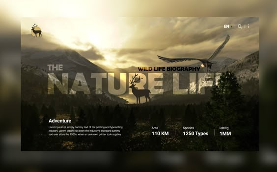

# AfriTour visual direction

## Purpose

Present the wildlife archive as a cinematic, editorial field journal. The supplied
`Insiration.jpg` is the art-direction reference: a quiet landscape, oversized type,
small numbered labels and restrained lines. Use the real forest photograph for the
hero rather than showing the reference screenshot and its sample figures as live data.
Keep the focus on recorded species, locations, observers and media; avoid unsupported
travel claims, invented weather, and promotional filler.

## Visual language

- Use the sunset Africa icon as the browser and app icon, and the matching transparent
  AfriTour wordmark in the light site header.
- Use the existing rainforest photograph for a full-width homepage banner.
- Set the page in deep forest green with warm ivory text and muted ochre accents.
- Use Outfit for large, confident display type, Playfair Display for italic emphasis,
  Plus Jakarta Sans for interface text and JetBrains Mono for small field labels.
- Favor fine rules, square image frames and restrained radii over glass panels, bright
  gradients and oversized rounded cards.
- Keep the homepage as a concise archive overview with direct links to separate
  photographs, records, map and trends pages. All navigation uses same-window links.
- Give each page the shared header, navigation and footer, with the current page
  identified in the navigation. Use fluid type and spacing; stack hero actions and
  summary figures on narrow screens.
- Use clear focus outlines, descriptive image text and reduced-motion support.
- Keep motion purposeful: reveal sections as they enter view, use subtle image movement
  on hover and avoid autoplay or motion that competes with the wildlife photography.

## Content rules

- Describe the records as observations, not as verified or African-only data.
- Render counts and dates from the records shown on the page.
- Do not show fixed weather, destinations, itineraries or other claims that are not
  supplied by the archive.
- Keep section labels short and factual.
